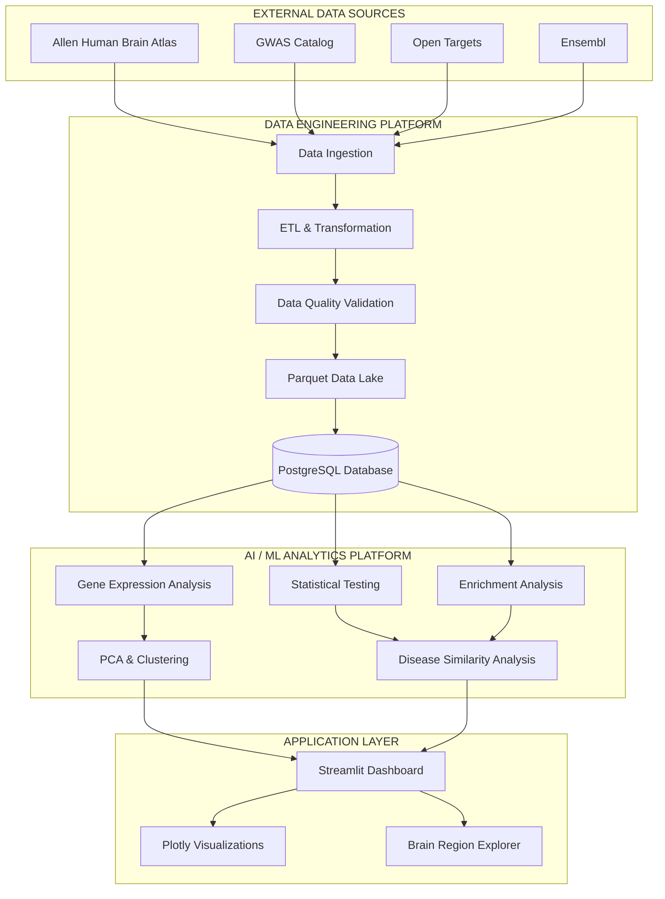
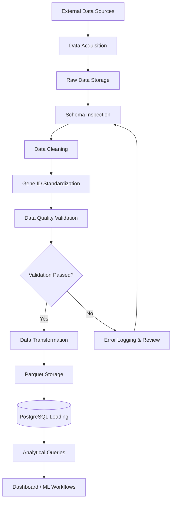
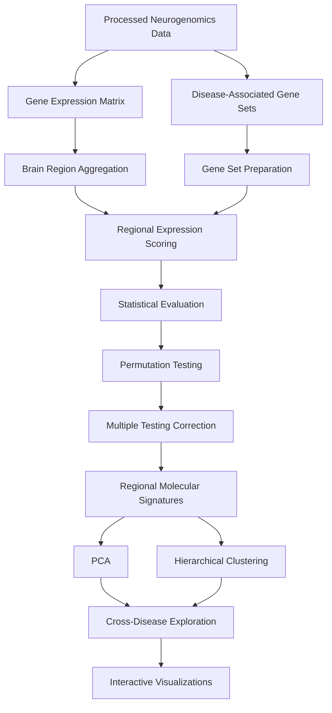
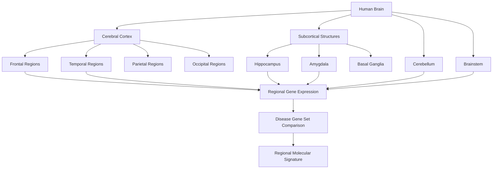
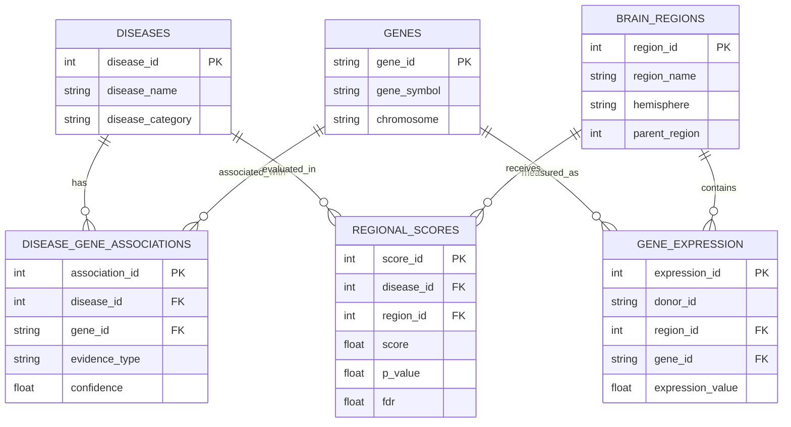

# 🧠 NeuroWeave
### Where Brain Data Meets Intelligence

<p align="center">
  <strong>An End-to-End Neurogenomics Data Engineering & AI/ML Platform</strong>
</p>

<p align="center">
  
  
  
  
  
</p>

---

## 01. Overview

**NeuroWeave** is an end-to-end neurogenomics intelligence platform designed to integrate brain-wide gene-expression data with disease-associated genetic information.

The platform combines data engineering, statistical computing, machine learning, and interactive visualization to investigate regional molecular signatures across neurological disorders.

By bringing together heterogeneous biological datasets, NeuroWeave aims to establish a reproducible analytical infrastructure for exploring relationships between genes, neurological disorders, and anatomical brain regions.

> Transforming complex brain data into structured, interpretable molecular insights.

### Core Vision

Build a unified computational platform that connects:

- Brain-wide gene expression
- Disease-associated genetic evidence
- Anatomical brain-region information
- Statistical and machine learning analysis
- Interactive molecular exploration

---

## 02. Problem Statement

Neurogenomics research involves multiple heterogeneous data sources, including gene-expression atlases, genetic association studies, gene annotations, and disease-related evidence.

These datasets often differ in:

- Data formats and structures
- Gene identifier systems
- Anatomical region definitions
- Experimental methodologies
- Evidence types and confidence levels

Integrating these resources into a reproducible analytical workflow requires systematic data engineering and carefully designed statistical methods.

**NeuroWeave addresses this engineering challenge by developing a unified data ingestion, transformation, storage, and analytical platform.**

---

## 03. Project Objectives

| Area | Objective |
|---|---|
| Data Integration | Integrate brain-expression and genetic association datasets |
| Data Engineering | Develop reusable multi-source ingestion pipelines |
| Data Quality | Implement validation, standardization and quality checks |
| Database Engineering | Design a relational PostgreSQL analytical database |
| Statistical Analysis | Investigate regional gene-expression patterns |
| Machine Learning | Explore molecular similarity using dimensionality reduction and clustering |
| Visualization | Build interactive brain-region and disease exploration tools |
| Reproducibility | Maintain traceable and repeatable analytical workflows |

---

# 04. System Architecture

NeuroWeave is designed around two interconnected systems sharing a common data infrastructure.

### High-Level Architecture



### Architecture Layers

| Layer | Responsibility |
|---|---|
| Source Layer | Acquire biological and genetic datasets |
| Ingestion Layer | Retrieve data through APIs and downloadable resources |
| Transformation Layer | Clean, standardize and transform datasets |
| Storage Layer | Store raw and processed data in Parquet and PostgreSQL |
| Analytics Layer | Execute statistical and machine learning workflows |
| Application Layer | Present analytical results through interactive interfaces |

*The architecture represents the intended system design. Components will be implemented and validated progressively.*

---

# 05. Data Engineering Pipeline

The Data Engineering subsystem focuses on building reliable and reproducible data workflows.

### ETL Workflow



### Planned Engineering Capabilities

- Reusable API and file-based ingestion modules
- Raw and processed data separation
- Schema validation and data contracts
- Duplicate and missing-value handling
- Gene identifier standardization
- Incremental loading where supported by source data
- PostgreSQL relational modeling
- Query optimization and indexing
- Workflow orchestration using Apache Airflow
- Automated pipeline testing and logging

---

# 06. AI/ML Analytics Pipeline

The analytical subsystem uses processed biological datasets to investigate regional molecular patterns.

### Analytical Workflow



### Planned Analytical Methods

| Method | Purpose |
|---|---|
| Regional Expression Scoring | Summarize gene-expression patterns across brain regions |
| Gene Set Enrichment | Investigate expression patterns associated with disease gene sets |
| Permutation Testing | Evaluate statistical significance against appropriate null models |
| FDR Correction | Control false discovery rates across multiple tests |
| PCA | Explore lower-dimensional representations |
| Hierarchical Clustering | Investigate similarities between molecular profiles |
| Correlation Analysis | Explore relationships between regional and disease-associated signals |

**Scientific considerations:** Donor variability, anatomical sampling, gene-set construction, multiple testing, and appropriate statistical null models will be considered during analysis.

---

# 07. Brain Region & Disease Exploration Map

NeuroWeave aims to connect disease-associated gene sets with anatomically organized brain-expression measurements.

The following conceptual map illustrates the intended exploration hierarchy.



### Planned Interactive Exploration

The dashboard will progressively support:

- Anatomical brain-region navigation
- Regional gene-expression exploration
- Gene-to-disease association inspection
- Cross-disease comparisons
- Regional molecular signature visualization
- Statistical evidence exploration

The anatomical hierarchy is conceptual at this stage; actual region identifiers and spatial coordinates will be derived from the selected atlas and its anatomical metadata.

---

# 08. Data Sources

NeuroWeave will integrate publicly available biological resources.

| Dataset / Resource | Role | Official Resource |
|---|---|---|
| Allen Human Brain Atlas | Human brain-wide gene-expression measurements | [Allen Brain Atlas](https://human.brain-map.org/) |
| GWAS Catalog | Genetic association studies and variants | [GWAS Catalog](https://www.ebi.ac.uk/gwas/) |
| Open Targets | Disease–target associations and evidence | [Open Targets](https://platform.opentargets.org/) |
| Ensembl | Gene annotation and identifiers | [Ensembl](https://www.ensembl.org/) |

### Dataset Integration Strategy

Each dataset will be accompanied by:

- Source identification
- Retrieval timestamp
- Original file metadata
- Data version or study identifier, where available
- Processing history
- Schema information
- Provenance documentation

Source-specific licensing, attribution, and data-use requirements will be reviewed before redistribution.

---

# 09. Technology Stack

### Programming & Data Processing

| Technology | Application |
|---|---|
| Python | Core development |
| NumPy | Numerical computing |
| Pandas | Data manipulation |
| SciPy | Scientific computing |
| PyArrow | Columnar data processing |

### Data Engineering & Storage

| Technology | Application |
|---|---|
| PostgreSQL | Relational analytical database |
| SQL | Data querying and transformation |
| Parquet | Efficient analytical storage |
| Requests | API ingestion |
| Apache Airflow | Workflow orchestration |

### Biological Computing & Analytics

| Technology | Application |
|---|---|
| abagen | Allen Human Brain Atlas processing |
| Nibabel | Neuroimaging data access |
| Nilearn | Neuroimaging analysis and visualization |
| GSEApy | Gene-set enrichment |
| Scikit-learn | Machine learning |
| SciPy | Statistical evaluation |

### Visualization & Application

| Technology | Application |
|---|---|
| Streamlit | Interactive dashboard |
| Plotly | Interactive visualizations |
| Matplotlib | Statistical plotting |

### Development & Quality

| Technology | Application |
|---|---|
| Git | Version control |
| GitHub | Source code management |
| Pytest | Automated testing |
| Pandera | Data validation |
| Docker | Containerization |
| Ruff | Python linting |

*The stack lists planned technologies; actual implementation will be reflected in project dependencies and documentation.*

---

# 10. Database Design

PostgreSQL will serve as the central relational analytical database.

### Proposed Core Entities



The schema will be refined according to the actual source data, identifier relationships, donor structure, and analytical requirements.

---

# 11. Project Structure

```text
NeuroWeave/
│
├── data/
│   ├── raw/
│   │   ├── ahba/
│   │   ├── gwas/
│   │   ├── open_targets/
│   │   ├── gene_annotations/
│   │   └── pathology/
│   │
│   ├── interim/
│   └── processed/
│
├── notebooks/
│
├── src/
│   ├── ingestion/
│   ├── preprocessing/
│   ├── database/
│   ├── analytics/
│   ├── visualization/
│   └── utils/
│
├── scripts/
├── dashboard/
│
├── results/
│   ├── figures/
│   └── tables/
│
├── configs/
├── tests/
├── logs/
├── docs/
│
├── requirements.txt
├── README.md
├── .gitignore
└── .env.example
```

---

# 12. Reproducibility & Data Quality

Reproducibility is a core engineering requirement.

The platform will progressively incorporate:

- Isolated Python environments
- Version-controlled source code
- Explicit dependency management
- Dataset provenance tracking
- Schema and type validation
- Automated testing
- Controlled random seeds for stochastic analyses
- Traceable analytical configurations
- Structured pipeline logging
- Documented transformation steps

Data quality checks will include:

| Check | Purpose |
|---|---|
| Schema Validation | Verify expected columns and data types |
| Missing Value Checks | Identify incomplete measurements |
| Duplicate Detection | Detect duplicate records |
| Identifier Validation | Verify gene and anatomical identifiers |
| Range Checks | Identify invalid numerical measurements |
| Referential Integrity | Maintain consistent database relationships |

---

# 13. Development Roadmap

| Phase | Development Milestone | Status |
|---|---|---|
| 01 | Project Foundation & Environment Setup | Completed |
| 02 | Multi-Source Data Acquisition | Planned |
| 03 | ETL & Data Quality Engineering | Planned |
| 04 | PostgreSQL Database Development | Planned |
| 05 | Workflow Orchestration | Planned |
| 06 | Statistical & Biological Analytics | Planned |
| 07 | Brain Region & Spatial Analysis | Planned |
| 08 | Machine Learning & Molecular Similarity | Planned |
| 09 | Interactive Dashboard Development | Planned |
| 10 | Testing, Containerization & Documentation | Planned |

---

# 14. Getting Started

### Prerequisites

- Python 3.11
- Git
- Visual Studio Code

### Clone the repository

```bash
git clone https://github.com/gaxxtri/NeuroWeave.git
cd NeuroWeave
```

### Create a virtual environment

Windows PowerShell:

```powershell
py -3.11 -m venv .venv
.\.venv\Scripts\Activate.ps1
```

### Install dependencies

```bash
python -m pip install -r requirements.txt
```

### Verify the environment

```bash
python scripts/verify_environment.py
```

---

# 15. Expected Outcomes

The intended deliverables include:

1. A reproducible neurogenomics data ingestion platform.
2. A validated, structured biological data repository.
3. A PostgreSQL analytical database.
4. Automated and testable ETL workflows.
5. Statistical gene-expression and enrichment analysis.
6. Exploratory machine learning models.
7. Interactive disease and brain-region exploration.
8. Technical documentation and reproducible workflows.

---

# 16. Scope & Scientific Disclaimer

NeuroWeave is an exploratory computational research and data analytics platform.

Its analytical outputs are intended to support data exploration and hypothesis generation. They are not validated clinical biomarkers and must not be used for medical diagnosis, treatment selection, or clinical decision-making.

---

## Project Information

| Attribute | Details |
|---|---|
| Project | NeuroWeave |
| Domain | Neurogenomics, Data Engineering, AI/ML |
| Language | Python |
| Database | PostgreSQL |
| Development Approach | Local-first |
| Repository | [github.com/gaxxtri/NeuroWeave](https://github.com/gaxxtri/NeuroWeave) |
| Current Stage | Foundation Completed — Data Engineering Next |

---

<p align="center">
  <strong>NeuroWeave</strong><br/>
  <em>Where Brain Data Meets Intelligence.</em>
</p>